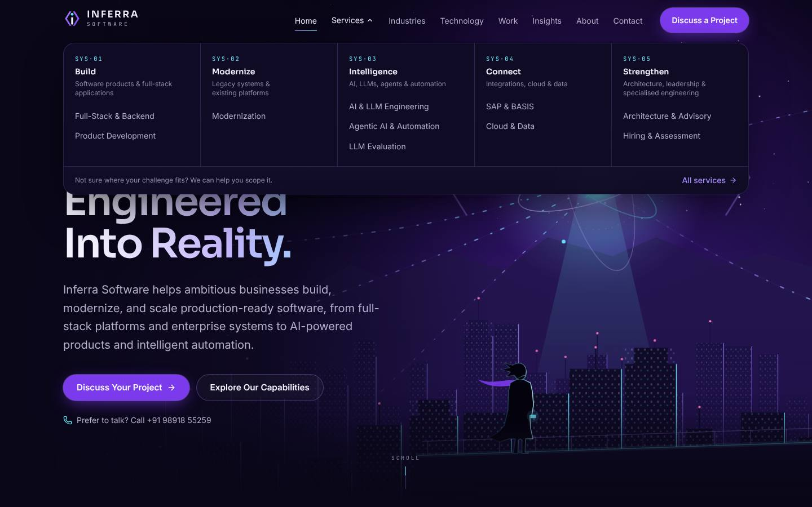
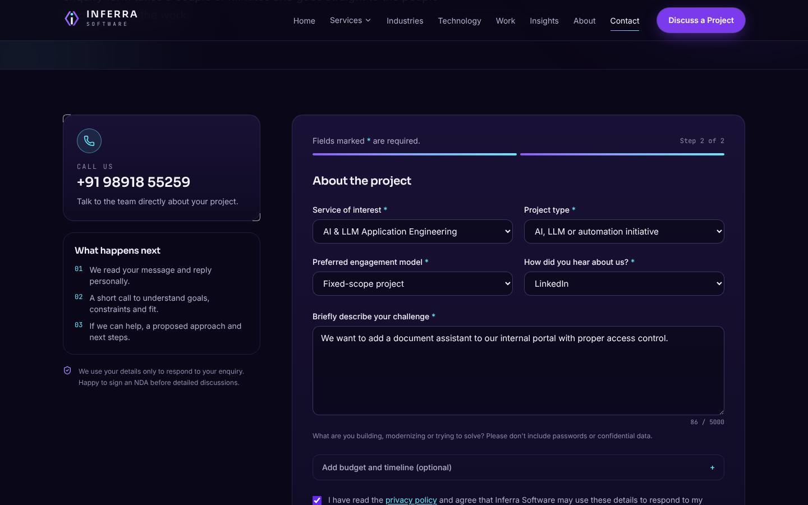

# Inferra Software website

The corporate website for **Inferra Software**: a cinematic, midnight-violet,
multi-page marketing site with an enquiry form, insights articles and
engineering demonstrators.

> *Complex ideas. Engineered into reality.*


<p>
  
  
  
</p>

Every page is statically prerendered; the only server code is the enquiry API.

## Contents

- [Features](#features) · [Tech stack](#tech-stack) · [Quick start](#quick-start) · [Routes](#routes)
- [Project structure](#project-structure) · [Editing content](#editing-content) · [Integrations](#integrations)
- [Enquiry form](#enquiry-form) · [Testing](#testing) · [Deployment](#deployment) · [Troubleshooting](#troubleshooting)
- [Decisions worth knowing](#decisions-worth-knowing) · [Documentation](#documentation) · [License](#license)

## Features

- **36 pages**: home, about, 10 service pages, 5 industry pages, technology, 5 engineering demonstrators, 5 MDX articles, careers, contact, privacy, terms, custom 404 and error pages.
- **Original brand system**: SVG logo in 13 variants, colour tokens checked for WCAG AA contrast, self-hosted fonts.
- **Cinematic artwork as code**: layered parallax hero, per-pillar illustrations, generated cover art. No stock images.
- **Two-step enquiry form** with shared client/server validation, spam protection, rate limiting, Resend email and webhook delivery, and an honest fallback when delivery is not configured.
- **SEO**: per-page metadata, Open Graph images, sitemap, robots, JSON-LD, one setting for the canonical domain, previews never indexed.
- **Accessibility**: WCAG 2.2 AA tested with axe, keyboard-friendly menus, skip link, visible focus, reduced-motion support.
- **Security**: Content Security Policy, HSTS, frame and MIME protections, no secrets in source.
- **Content-first**: all copy lives in typed config and MDX files, so non-developers can edit it safely.

## Tech stack

| Area | Choice |
| --- | --- |
| Framework | Next.js 16 (App Router, Turbopack, Cache Components, partial prefetching) |
| UI | React 19, TypeScript 5, Tailwind CSS v4, lucide-react icons |
| Content | MDX (`@next/mdx`, remark-gfm, rehype-slug), typed TypeScript content files |
| Validation | zod (shared by form and API) |
| Email | Resend REST API (no SDK), optional webhook |
| Analytics | Plausible (optional, cookieless) |
| Testing | Vitest, Playwright, axe-core |
| Hosting | Any Node.js host; Vercel recommended |

## Quick start

Requirements: Node.js 20.9 or newer (developed on Node 22) and npm.

```bash
npm install
npm run dev            # http://localhost:3000
```

No environment variables are needed to run the site. Copy `.env.example` to
`.env.local` when you want to turn on integrations.

| Command | What it does |
| --- | --- |
| `npm run dev` | Development server with hot reload |
| `npm run build` | Production build (type-checks and prerenders every page) |
| `npm start` | Serve the production build |
| `npm run lint` | ESLint (Next.js core web vitals + TypeScript rules) |
| `npm run typecheck` | `tsc --noEmit` |
| `npm test` | Unit tests (Vitest) |
| `npm run test:e2e` | Browser tests (Playwright): builds, starts and tests the site |
| `npm run check` | Lint, type check, unit tests and build in one go |
| `npm run brand` | Regenerate the SVG logo files from `scripts/generate-brand-assets.mjs` |
| `npm run brand:png` | Re-render PNG icons from the SVGs (needs Playwright Chromium) |

For Playwright, install a browser once with `npx playwright install chromium`,
or point `PLAYWRIGHT_CHROMIUM_PATH` at an existing Chromium binary.

## Routes

| Route | Purpose |
| --- | --- |
| `/` | Home: hero, credibility, capability explorer, featured services, approach, demonstrators, team, technology, insights, call to action |
| `/about` | Company story, principles, founder and team |
| `/services` | All ten services, grouped into five capability areas |
| `/services/[slug]` | Ten service pages (full-stack, product development, modernization, AI & LLM, agentic AI, LLM evaluation, SAP & BASIS, cloud & data, architecture & advisory, hiring & assessment) |
| `/industries`, `/industries/[slug]` | Five industry pages, written as general expertise, not client claims |
| `/technology` | Technology groups with established strengths vs project-dependent tools |
| `/work`, `/work/[slug]` | Five clearly labelled engineering demonstrators |
| `/insights`, `/insights/[slug]` | Five MDX articles with table of contents, reading progress and share links |
| `/careers` | Engineering principles, talent network and partnership enquiries |
| `/contact` | Phone (primary), two-step enquiry form, optional booking link |
| `/privacy`, `/terms` | Draft legal pages (marked for legal review) |
| Unknown URLs | Custom 404; runtime errors show a branded error page |

Generated files: `/sitemap.xml`, `/robots.txt`, `/manifest.webmanifest`,
Open Graph images (`/opengraph-image` and per service, work and article page),
`/icon.svg` and `/apple-icon.png`.

## Project structure

```
src/
  app/                 Routes, metadata files, API route
  components/          UI, layout, artwork, page sections, form
  config/              site.ts (contact, links, SEO), messaging.ts (slogan and copy), navigation.ts
  content/             Typed content: services, industries, work, team, careers, technology, insights (MDX), legal (MDX)
  lib/                 SEO, security headers, structured data, analytics, enquiry validation and delivery
public/brand/          Logo files (SVG + PNG)
scripts/               Brand asset generators
tests/unit/            Vitest
tests/e2e/             Playwright
docs/                  Brand, content, deployment, testing and launch documents
```

## Editing content

Almost all copy lives in `src/config` and `src/content`, not in components.
See **[docs/CONTENT-GUIDE.md](docs/CONTENT-GUIDE.md)** for how to change
contact details, add a team bio, publish an article, add a demonstrator or a
real case study, and open a job role.

The rule throughout: **leave a value `null` or empty until it is real.**
Components hide anything that is missing, so placeholders never reach the
live site. In development, small dashed "dev notes" mark where information is
still needed; they never render in production.

## Integrations

All integrations are configured with environment variables (see
`.env.example`) and are off until configured.

- **Canonical domain**: `NEXT_PUBLIC_SITE_URL`. The domain appears in no source
  file. Without it, canonical links are omitted.
- **Indexing**: `SITE_INDEXING=enabled`. Off by default; preview deployments on
  Vercel are never indexed, even when it is set (`X-Robots-Tag`, robots meta and
  `robots.txt` all follow this switch).
- **Enquiry email**: `RESEND_API_KEY`, `ENQUIRY_TO_EMAIL`, `ENQUIRY_FROM_EMAIL`.
- **Enquiry webhook**: `ENQUIRY_WEBHOOK_URL` (+ optional `ENQUIRY_WEBHOOK_SECRET`)
  posts each enquiry as JSON, for a CRM or automation tool. Email and webhook
  can run together; delivery succeeds if either accepts it.
- **Booking link**: `NEXT_PUBLIC_BOOKING_URL` shows "Book a call" buttons.
- **Analytics**: `NEXT_PUBLIC_PLAUSIBLE_DOMAIN` loads cookieless Plausible and
  sends the events listed in `src/lib/analytics.ts` (CTA, call, booking clicks,
  enquiry outcomes, service/case study/article views). The CSP is widened only
  for the analytics origin when enabled.

## Enquiry form

Two steps, with client and server validation sharing one zod schema
(`src/lib/enquiry/schema.ts`). Protections on `POST /api/enquiry`:

- same-origin check, JSON only, 20 KB body limit;
- rate limit of 5 requests per 10 minutes per client (hashed IP);
- honeypot field and a minimum fill time, both answered with a silent success;
- duplicate suppression for 10 minutes;
- HTML escaping and header sanitisation in outgoing email; enquiry content is never logged.

If delivery is not configured, or fails, the form keeps the visitor's message
and offers the phone number (and email or booking link when configured),
plus a "copy message" button. Nothing is ever silently lost.

UTM parameters and the referrer are captured on the first page view
(sessionStorage) and attached to the enquiry.

## Testing

```bash
npm run lint          # ESLint
npm run typecheck     # TypeScript
npm test              # 38 unit tests (Vitest)
npm run test:e2e      # 47 browser tests (Playwright): builds and serves the site first
```

The browser suite checks every route, real 404s, menus, a full internal link
crawl, phone links, the enquiry form and API, axe accessibility scans on 14
pages, console errors, CSP violations and horizontal overflow from 360 to
1920 px. To run it against a deployed site:
`PLAYWRIGHT_BASE_URL=https://your-domain npx playwright test`.

Latest results: [docs/TESTING-REPORT.md](docs/TESTING-REPORT.md).

## Deployment

Short version for Vercel: import the repository, set the environment variables
from `.env.example` for Production, deploy, add your domain, then turn on
`SITE_INDEXING=enabled` when you are ready to be found. The full guide (domain,
DNS, Resend setup, smoke test, rollback) is in
[docs/DEPLOYMENT.md](docs/DEPLOYMENT.md).

## Troubleshooting

| Problem | Fix |
| --- | --- |
| `npm install` fails or Next.js refuses to start | Check `node -v` is 20.9 or newer. |
| Form says "Online enquiries are not available yet" | Expected until `RESEND_API_KEY`, `ENQUIRY_TO_EMAIL` and `ENQUIRY_FROM_EMAIL` (or `ENQUIRY_WEBHOOK_URL`) are set. |
| Dashed "dev notes" appear on pages | They show only in `npm run dev` and mark missing details such as the business email. They never render in production. |
| Playwright says no browser is installed | Run `npx playwright install chromium`, or set `PLAYWRIGHT_CHROMIUM_PATH` to an existing Chromium binary. |
| Port 3000 is busy | `npm run dev -- -p 3001` |
| Search engines can't see the site | Indexing is off by default. Set `SITE_INDEXING=enabled` on the production deployment. |
| Changes to environment variables don't apply | Restart `npm run dev`, or redeploy on Vercel. |

## Decisions worth knowing

- **Static CSP with `'unsafe-inline'` scripts.** Pages are prerendered, so
  per-request nonces would force every page to render dynamically. All other
  directives are strict (`frame-ancestors 'none'`, `object-src 'none'`,
  `form-action 'self'`, no third-party origins unless analytics is enabled).
- **In-memory rate limiting.** Adequate for a low-traffic marketing site and
  still stops bursts, but each serverless instance has its own memory. Swap
  the store in `src/lib/enquiry/rate-limit.ts` for Upstash Redis or Vercel KV
  if abuse appears.
- **Plausible for analytics.** Cookieless, so no cookie banner is required for
  analytics in most cases; confirm for your markets.
- **Real 404 status codes.** Detail pages stream, so `src/proxy.ts` checks
  slugs before rendering to return a true 404 for unknown pages.
- **Artwork is code.** The hero scene, pillar illustrations, cover art and
  avatars are SVG components: no stock images, no photographs of people,
  instant loading. Abstract avatars are deliberately non-photographic.
- **Fonts are self-hosted** (Inter, Sora, JetBrains Mono; SIL Open Font License),
  so no requests go to Google Fonts.

## Documentation

- [docs/BRAND.md](docs/BRAND.md): logo, rationale, colour tokens and contrast, typography, voice
- [docs/CONTENT-GUIDE.md](docs/CONTENT-GUIDE.md): how to edit everything
- [docs/DEPLOYMENT.md](docs/DEPLOYMENT.md): domain, Vercel, DNS, email, launch smoke test, rollback
- [docs/TESTING-REPORT.md](docs/TESTING-REPORT.md): what was tested and the results
- [docs/LAUNCH-CHECKLIST.md](docs/LAUNCH-CHECKLIST.md): information the founder must provide before launch

## License

Copyright (c) 2026 Inferra Software. All rights reserved. The repository is
public for transparency, but the code, content and brand assets are not open
source; see [LICENSE](LICENSE). Bundled fonts are under the SIL Open Font
License and dependencies under their own licences; see
[THIRD_PARTY_NOTICES.md](THIRD_PARTY_NOTICES.md).
